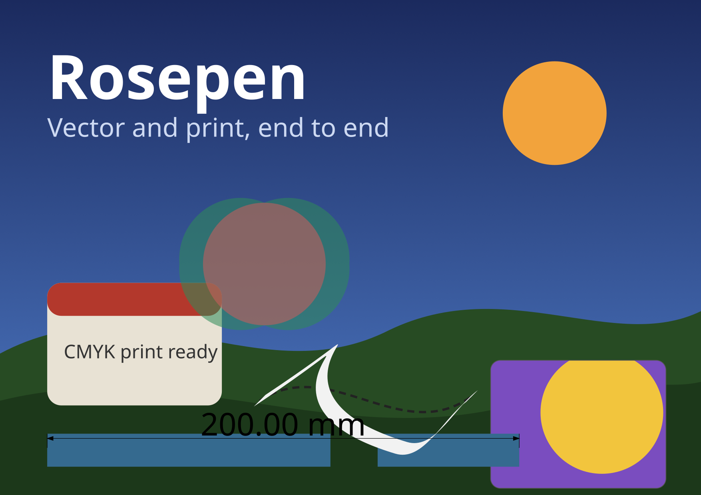

<!--
SPDX-License-Identifier: GPL-2.0-or-later
-->

# Rosepen

**Vector illustration and print, end to end — a free and open-source editor for Linux.**

Rosepen is a fork of [Inkscape](https://gitlab.com/inkscape/inkscape) that pairs the proven
upstream SVG engine with a professional print-and-design workspace: document CMYK with ICC and
spot color, multi-page documents with master layers, PDF/X-1a and PDF/X-4 export with bleed and
crop marks, a flyout toolbox with context property bar, dockable panels, and a production toolset
— container clipping, dimension tools, artistic strokes, smart fill and live sketching —
re-implemented clean-room from documented behavior.


---

## Highlights

| | |
|---|---|
| **Color you can print** | Document-wide CMYK output profile, ICC color management, soft-proofing with gamut and over-ink indicators, named spot colors and swatches. |
| **Pages and PDF/X** | Multi-page documents with per-page sizes and a master layer shown on every page; PDF/X-1a and PDF/X-4 export with output intent, bleed, crop marks and a preflight pass. |
| **A workspace for long sessions** | Toolbox with flyouts, context-sensitive property bar, dockable panel system (Object Manager, Object Properties), workspace presets and a complete shortcut scheme. |
| **Tools that draw with you** | Container clipping (place inside frame, edit contents in place, extract), live dimension and measure tools, artistic strokes from presets, brushes and a calligraphic nib on an editable skeleton, smart fill of enclosed regions, freehand strokes smoothed live while you draw. |
| **Made to be automated** | Every feature is a command-line action (`rosepen <file.svg> --actions="…"`), and an MCP server lets coding agents create and edit documents headlessly. |

## Features

- **CMYK, ICC and spot color** — first-class CMYK in documents, fills and export; soft-proof
  display transform; spot/named color swatches that survive the PDF/X round trip.
- **Multi-page documents** — a page manager panel, page insert/duplicate/move/rename/resize, and
  a master layer rendered on every page.
- **Print-ready PDF/X** — PDF/X-1a and PDF/X-4 with OutputIntent, bleed, crop marks and a
  preflight pass before export.
- **Classic workspace** — flyout toolbox groups, selection-driven property bar, docker panel
  system, vertical palette, workspace presets and a golden-table keymap.
- **`.cdr` import and export** — open multi-page `.cdr` files with true CMYK and spot colors
  through a native bridge to the TraceDraw `cdr` crate (libcdr as fallback), and save documents
  back to `.cdr`.
- **Production tools**
  - *Container clipping* — place objects inside a frame, edit contents in place, extract,
    normalize and repair.
  - *Dimension tools* — live dimension annotations (horizontal, vertical, aligned, segment,
    angular) that follow their objects.
  - *Artistic strokes* — preset, brush and calligraphic strokes that stay live on an editable
    skeleton path.
  - *Smart fill* — click any region enclosed by object boundaries and get a new object filling
    exactly that region.
  - *Live sketch* — freehand strokes that are smoothed into clean Bézier curves while you draw.

## Screenshots



The workspace screenshot above shows a poster drawn in Rosepen: a gradient sky, a container
frame clipping its contents, a white calligraphic artistic stroke over its dashed skeleton path,
a 200 mm live dimension, and a two-page document (the second page peeks in on the left).

## Automating Rosepen

Every interactive feature is reachable headlessly:

```sh
rosepen poster.svg --actions="select-by-id:art,frame;object-powerclip-place;export-filename:out.png;export-do"
```

The repository also ships an MCP server (`tools/rosepen-mcp`) so coding agents can create
documents, style objects and render previews over stdio.

## Building

```sh
git clone https://github.com/toel1234/rosepen.git
cd rosepen
git submodule update --init
cmake -S . -B build -DCMAKE_BUILD_TYPE=Release
ninja -C build
./build/bin/rosepen
```

See [doc/building/readme.md](doc/building/readme.md) for dependencies and
[fork/README.md](fork/README.md) for the fork layout, branding pipeline and the local
AppImage build (`fork/scripts/build-local.sh`).

## Status

All 21 plans of the **v0.1** milestone are complete (Phases 1–6), including `.cdr` import and
export. Manual UI acceptance testing and a polish pass are under way before the first release.

## Provenance and references

- Rosepen is a fork of [Inkscape](https://gitlab.com/inkscape/inkscape) (1.5-dev, master of
  2026-10-20) and remains **GPL-2.0-or-later** — all credit for the upstream code, history and
  artwork belongs to the Inkscape project and its contributors.
- The production toolset is re-implemented clean-room from documented behavior. We thank
  [TraceDraw](https://github.com/igtoth/tracedraw) (MIT OR Apache-2.0) — an independent,
  clean-room vector editor — for demonstrating how far open-source re-implementation of a
  classic print-and-design workflow can go.

## License

[GPL-2.0-or-later](COPYING) — see [LICENSES/](LICENSES) for the full license texts.
